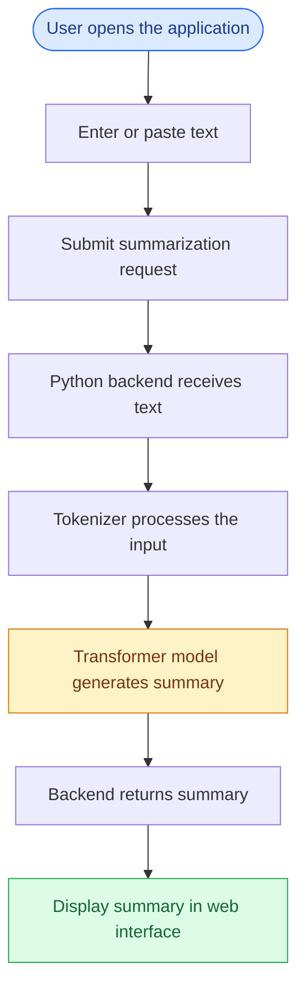

# ✨ Text Summarizer using Hugging Face Transformers

<p align="center">
  <b>Transform long text into concise, meaningful summaries using Natural Language Processing.</b>
</p>

<p align="center">
  
  
  
  
  
</p>

---

## 📌 Overview

**Text Summarizer** is a machine learning web application that generates concise summaries from lengthy text using Natural Language Processing (NLP) and Hugging Face Transformer models.

In today's information-driven world, reading and understanding large amounts of text can be time-consuming. This project aims to simplify that process by extracting the essential information from user-provided content and presenting it in a shorter, more readable format.

The application provides a simple web interface where users can enter or paste text, request a summary, and view the generated result without manually reading the entire input.

The project integrates a trained or pretrained summarization model with a Python backend and an interactive frontend.

## 🎯 Project Objectives

- Build a practical NLP application for automatic text summarization.
- Apply Transformer-based models to a real-world text processing task.
- Develop a user-friendly web interface for text input and summary output.
- Integrate the machine learning model with a Python web backend.
- Explore the process of saving, loading, and deploying a machine learning model.
- Create a foundation for future improvements in summarization quality and performance.

## ✨ Features

- **Automatic Text Summarization:** Generate shorter versions of lengthy text.
- **Transformer-Based NLP:** Use Hugging Face Transformers for model inference.
- **Simple Web Interface:** Enter or paste text into a clean, easy-to-use interface.
- **Instant Result Display:** View the generated summary directly on the page after processing.
- **Backend Integration:** Send text to the Python application through an HTTP request.
- **Saved Model Support:** Load a locally saved model and its tokenizer, if configured in the application.
- **Error Handling:** Display errors when the summarization request fails.
- **Responsive Design:** Use the application on desktop and mobile-sized screens.

## 🧠 Technology Stack

| Technology | Purpose |
|---|---|
| Python | Backend development and model inference |
| Hugging Face Transformers | Transformer model loading and text generation |
| PyTorch or the configured model backend | Model computation |
| HTML5 | Web page structure |
| CSS3 | Interface styling and responsive layout |
| JavaScript | Form handling and asynchronous API requests |
| Flask or the configured Python framework | Backend routing and HTTP requests |

> **Note:** The exact backend framework and model computation library depend on the implementation in `app.py`. Update this section if your project uses different technologies.

## ⚙️ How It Works

The application follows a straightforward text summarization workflow:

1. **User Input:** The user enters or pastes a block of text into the web interface.
2. **Request Submission:** JavaScript captures the input and sends it to the backend through an HTTP POST request.
3. **Input Processing:** The backend receives the text and prepares it for the summarization model.
4. **Tokenization:** The tokenizer converts the input text into the representation expected by the model.
5. **Model Inference:** The Transformer model generates a concise summary.
6. **Response Generation:** The backend returns the generated summary to the frontend.
7. **Result Display:** The interface displays the summary to the user.

### 🔄 Application Workflow



## 🏗️ Project Structure

The project is organized around a Python backend, a web interface, and the saved summarization model.

```text
text-summarizer/
│
├── app.py
│
├── index.html
│
├── saved_summary_model/
│   ├── config.json
│   ├── tokenizer_config.json
│   ├── tokenizer.json
│   ├── special_tokens_map.json
│   ├── generation_config.json
│   └── model weights and other required files
│
├── requirements.txt
│
└── README.md
```

> **Important:** This is an illustrative structure. Keep your actual project layout unchanged if your application already references these files in different locations. Some model files listed above may not exist in your saved model directory.

## 🚀 Getting Started

Follow these instructions to run the project locally.

### Prerequisites

Make sure you have the following installed:

- Python 3.10 or a compatible version for your dependencies.
- pip, the Python package installer.
- Git, if you want to clone the repository.
- Sufficient memory and storage to load the selected Transformer model.

### 1. Clone the Repository

```bash
git clone https://github.com/YOUR-USERNAME/text-summarizer.git
```

Navigate to the project directory:

```bash
cd text-summarizer
```

Replace `YOUR-USERNAME` with your GitHub username.

### 2. Create a Virtual Environment

```bash
python -m venv venv
```

Activate it on Windows:

```bash
venv\Scripts\activate
```

On macOS or Linux:

```bash
source venv/bin/activate
```

### 3. Install Dependencies

```bash
pip install -r requirements.txt
```

Ensure that `requirements.txt` contains the dependencies required by your application.

### 4. Verify the Model Files

Check that the saved model directory exists and contains all required model weights, configuration files, and tokenizer files.

The path used in `app.py` must match the actual model directory.

### 5. Run the Application

For a Flask application, the command is typically:

```bash
python app.py
```

Open the local URL printed by your application in your browser, commonly:

```text
http://127.0.0.1:5000/
```

The URL and port depend on your backend configuration.

## 💻 Usage

1. Open the application in your browser.
2. Enter or paste the text you want to summarize.
3. Click the **Summarize** button.
4. Wait while the backend processes the text.
5. Read the generated summary in the Content Summary section.

For best results, provide meaningful text and stay within the input length supported by your model.

## 📊 Example

**Sample input:**

> Artificial intelligence is transforming many industries by enabling computers to perform tasks that traditionally require human intelligence. Natural Language Processing allows computers to understand, process, and generate human language. Transformer architectures have significantly improved NLP tasks such as translation, question answering, and text summarization. Automatic summarization helps users understand lengthy documents more efficiently by presenting their key information in a shorter form.

**Illustrative summary:**

> Artificial intelligence and Transformer-based NLP are improving language-related tasks. Automatic text summarization helps users understand lengthy documents by presenting their key information concisely.

*Example output is illustrative. Actual summaries depend on the model, its configuration, and the input text.*

## 🧪 Potential Applications

This project can be extended for use in:

- 📚 Summarizing educational materials and study notes.
- 📰 Condensing news articles and reports.
- 📄 Extracting key information from long documents.
- 💼 Summarizing meeting notes and business content.
- 🔬 Supporting research and document review.
- 📝 Creating concise versions of lengthy text.

These are potential use cases rather than claims that every input format has been tested.

## ⚠️ Limitations

- Summary quality depends on the selected model and the input text.
- Very long inputs may exceed the model's token limit.
- Generated summaries may omit important details or occasionally contain inaccurate information.
- Inference speed depends on the model size and available hardware.
- Large models may require additional RAM, disk space, or GPU resources.
- The application should not be assumed to preserve every fact from the original text.

Always review generated summaries when accuracy is important.

## 🔮 Future Improvements

Potential future enhancements include:

- [ ] Add adjustable summary length.
- [ ] Support document and PDF uploads.
- [ ] Display input and output word counts.
- [ ] Add a copy-to-clipboard feature.
- [ ] Improve loading indicators and error messages.
- [ ] Support additional summarization models.
- [ ] Optimize inference speed and memory usage.
- [ ] Deploy the application to a public hosting platform.
- [ ] Add automated tests for backend and summarization functionality.

## 🌐 Deployment

The application can potentially be deployed to a cloud hosting platform that supports its Python framework and model requirements.

Possible platforms include:

- [Render](https://render.com/)
- [Hugging Face Spaces](https://huggingface.co/spaces)
- [Railway](https://railway.com/)

Deployment requirements depend on the application framework, model size, available memory, and how the model files are stored.

Before deployment, configure the production server, install the required dependencies, and ensure that the model files can be accessed by the running application.

## 🔒 Model and Repository Considerations

- Include all necessary model files if the application loads the model from a local directory.
- Consider Git LFS or external model storage for large model weights.
- Do not upload API keys, passwords, access tokens, or private credentials.
- Check the model's license and redistribution requirements before publishing its weights.
- Avoid committing virtual environments, caches, and temporary files.

## 🤝 Contributing

Suggestions and improvements are welcome.

1. Fork the repository.
2. Create a feature branch.
3. Make your changes.
4. Test the application.
5. Submit a pull request describing your improvements.

## 📄 License

Choose a license appropriate for your source code and verify that the model's license permits your intended use and redistribution.

If you intend to publish this project as open source, consider adding a `LICENSE` file to the repository.

## 👨‍💻 Author

**YOUR NAME**

- GitHub: [@sudeepsharmatalu](https://github.com/sudeepsharmatalu)

Replace the placeholders with your details.

---

<p align="center">
  <b>Built with Python, NLP, and Hugging Face Transformers.</b>
  <br>
  Turning lengthy text into concise, meaningful insights.
</p>
